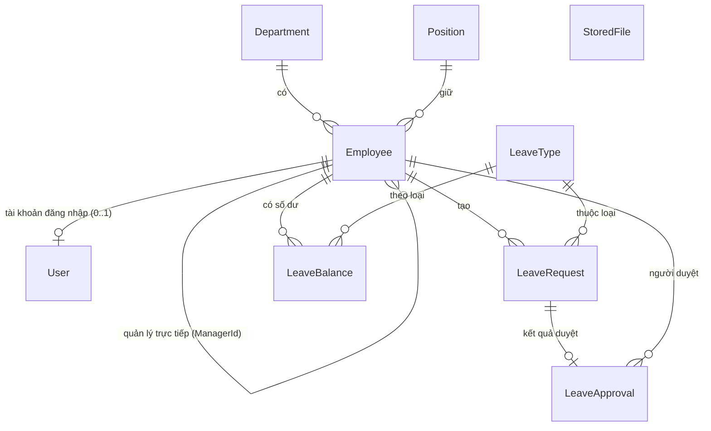

# LeaveManage — Back-end quản lý ngày nghỉ của nhân sự

**Đề tài #2:** Thiết kế Back-end cho hệ thống quản lý ngày nghỉ của nhân sự
**Môn học:** Lập trình .NET Core — **Nhóm 12:** Hồ Thanh Phong, Nguyễn Lê Hưng, Xiêng Lăng Đức Mạnh

LeaveManage là ASP.NET Core Web API (.NET 10) **phát triển tiếp từ bài thực hành LTW22** của nhóm. Hệ thống gồm:
- quản lý nhân viên, phòng ban, chức vụ, loại nghỉ;
- luồng đơn nghỉ: tạo nháp → gửi duyệt → duyệt / từ chối → hủy;
- số dư phép theo năm và lịch sử duyệt.

Đi kèm một giao diện web Bootstrap (tiếng Việt) gọi API thật.

> Thư mục gốc `LTW22` được giữ nguyên.
> - Bản sao lưu: `D:\Study\LTW2\Code\LTW22_backup_20261125`.
> - Mã nguồn đồ án: `D:\Study\LTW2\Code\LeaveManage`.

---

## 1. Công nghệ

| Thành phần | Phiên bản / Ghi chú |
|---|---|
| Nền tảng | .NET SDK 10, ASP.NET Core Web API (Controllers) |
| Dữ liệu | EF Core 10.0.12 (Code First, Migration), SQL Server LocalDB `(localdb)\MSSQLLocalDB` |
| Xác thực | JWT Bearer (HS256) + Refresh Token (xoay vòng, lưu bản băm SHA-256) |
| Mật khẩu | HMACSHA512 với salt ngẫu nhiên cho từng tài khoản (cách làm của Lab Buổi 8) |
| Tài liệu API | Swashbuckle 7.2.0 (Swagger UI có nút Authorize, chỉ bật ở Development) |
| Log | Serilog (Console), middleware ghi log request kèm TraceId |
| Giao diện | HTML + JavaScript (ES Modules) + Bootstrap 5.3, phục vụ từ `wwwroot` |
| Kiểm thử | xUnit + WebApplicationFactory trên SQL Server thật (`LeaveManage_Test`), Postman/Newman, Playwright (Chrome) |

## 2. Kiến trúc

```
Controllers  →  Services  →  Repositories  →  AppDbContext (EF Core)  →  SQL Server
   (HTTP)       (nghiệp vụ,     (truy vấn,          (Fluent API,
                 kiểm quyền)      transaction)        HasData)
```

- **Controller:** nhận request, đọc người gọi từ JWT (`CallerContext.From(User)`) rồi gọi Service. Controller không có nghiệp vụ.
- **Service:** kiểm tra nghiệp vụ và quyền sở hữu, ví dụ [Services/LeaveRequestService.cs](Services/LeaveRequestService.cs).
- **Repository:** nơi duy nhất dùng `AppDbContext`. Controller và Service không dùng DbContext trực tiếp.
- **Lỗi:** nghiệp vụ ném `AppException` (400/403/404/409). [Middleware/ExceptionHandlingMiddleware.cs](Middleware/ExceptionHandlingMiddleware.cs) trả JSON thống nhất gồm `statusCode`, `message`, `errorCode`, `traceId`.
- **DI:** đăng ký trong [Program.cs](Program.cs). Repository và Service là `AddScoped`, `PasswordService` là `AddSingleton`.

## 3. Cơ sở dữ liệu (9 entity)



Bảng `StoredFile` độc lập, phục vụ chức năng upload file từ LTW22.

| Quan hệ | Cài đặt |
|---|---|
| 1-n | Department → Employee, LeaveType → LeaveRequest, Employee → LeaveRequest |
| n-n có thuộc tính | Employee ↔ LeaveType qua `LeaveBalance` (Year, InitialDays, UsedDays, PendingDays) |
| 1-0..1 | Employee ↔ User (`User.EmployeeId` unique có lọc `WHERE EmployeeId IS NOT NULL`) |
| Tự tham chiếu | `Employee.ManagerId` → người duyệt đơn |

Ràng buộc trong [Data/AppDbContext.cs](Data/AppDbContext.cs):
- **Unique:** mã/email nhân viên; mã phòng ban, chức vụ, loại nghỉ; username/email tài khoản; mã đơn; (EmployeeId, LeaveTypeId, Year) của số dư; `LeaveApproval.LeaveRequestId`.
- **Check constraint:** `EndDate >= StartDate`; số ngày trong số dư không âm.
- **Khóa ngoại:** `Restrict` / `NoAction`, không xóa dây chuyền.

## 4. Quy tắc nghiệp vụ (quy tắc riêng của nhóm)

| Quy tắc | Cách làm |
|---|---|
| Đếm ngày nghỉ | Chỉ đếm **Thứ 2 – Thứ 6**, tính cả ngày đầu và cuối ([Services/LeaveDayCalculator.cs](Services/LeaveDayCalculator.cs)). Chưa trừ ngày lễ. Khoảng chỉ gồm T7/CN → 400. |
| Ngày hợp lệ | Ngày kết thúc phải ≥ ngày bắt đầu. Không được kéo sang năm sau (phải tách 2 đơn). |
| Báo trước | Ngày bắt đầu ≥ hôm nay + `NoticeDaysRequired` của loại nghỉ (phép năm 3 ngày, ốm 0 ngày...). Kiểm tra cả khi tạo lẫn khi gửi duyệt. |
| Trùng ngày | Không được trùng với đơn **Pending / Approved** khác của cùng nhân viên → 409 `OVERLAPPING_REQUEST`. |
| Số dư | Loại có `AllowsDeduction` (phép năm, phép ốm) phải có số dư năm đó và đủ ngày, nếu không → 409 `INSUFFICIENT_BALANCE` / `NO_BALANCE`. Loại không trừ số dư nhưng có giới hạn/năm (cưới 3 ngày, thai sản 180 ngày) thì kiểm tra tổng ngày trong năm. |
| Trừ số dư | Gửi duyệt: `PendingDays += n`. Duyệt: `PendingDays -= n`, `UsedDays += n`. Từ chối: `PendingDays -= n`. Hủy đơn Pending: `PendingDays -= n`. Hủy đơn Approved: `UsedDays -= n`. Còn lại = Cấp − Đã dùng − Đang chờ. |
| Người duyệt | Quản lý trực tiếp (`Employee.ManagerId`) hoặc Admin. Không ai tự duyệt đơn của mình (403). Mọi loại nghỉ đều cần duyệt. |
| Hủy | Chủ đơn hoặc Admin. Draft/Pending hủy được ngay. Approved chỉ hủy trước ngày bắt đầu. |
| Xử lý một lần | Chỉ duyệt/từ chối đơn đang Pending; xử lý lại → 409 `ALREADY_PROCESSED`. Bảng `LeaveApprovals` có unique `LeaveRequestId` làm lớp chặn cuối ở database. |
| Đồng thời | Mọi thao tác thay đổi đơn/số dư của một nhân viên chạy trong transaction và khóa dòng Employee bằng `UPDLOCK`, nên hai yêu cầu cùng lúc chạy tuần tự (ví dụ 2 người duyệt cùng lúc: 1 thành công, 1 nhận 409). |
| Phạm vi dữ liệu | **User:** chỉ dữ liệu của mình. **Manager:** của mình + nhân viên cấp dưới trực tiếp. **Admin:** tất cả. Ngoài phạm vi → 404 (không tiết lộ dữ liệu tồn tại). |
| Expired | Trạng thái `Expired` có trong enum nhưng **chưa có tác vụ tự động** chuyển đơn sang Expired (xem IMPLEMENTATION_STATUS). |

## 5. Cài đặt và chạy

Yêu cầu: .NET SDK 10, SQL Server LocalDB, công cụ `dotnet-ef` 10.x.

```powershell
cd D:\Study\LTW2\Code\LeaveManage

# 1) Bí mật: KHÔNG lưu trong repository (đã cấu hình sẵn trên máy demo)
dotnet user-secrets set "Jwt:Key" "<chuỗi ngẫu nhiên tối thiểu 32 ký tự>"
dotnet user-secrets set "Seed:DemoPassword" "<mật khẩu demo>"

# 2) Tạo database LeaveManageDb (ở Development, ứng dụng cũng tự migrate khi khởi động)
dotnet ef database update

# 3) Chạy
dotnet run --launch-profile https
```

- **Giao diện web:** https://localhost:7103/
- **Swagger:** https://localhost:7103/swagger
  - Đăng nhập bằng `POST /api/Users/login`, chép `token` vào nút **Authorize**.

**Tài khoản demo** (tạo tự động ở Development):

| Tài khoản | Vai trò | Nhân viên |
|---|---|---|
| `admin` | Admin | NV001 |
| `manager` | Manager | NV002, quản lý trực tiếp NV003, NV004, NV006 |
| `nv003`, `nv004`, `nv006` | User | Cấp dưới của manager |
| `nv005` | User | Quản lý trực tiếp là NV001 (admin) |

Mật khẩu chung nằm trong file local `demo-accounts.local.txt` (đã gitignore).

## 6. Kiểm thử

```powershell
dotnet test LeaveManage.sln       # 20 integration test, tự tạo lại database LeaveManage_Test
```

- **Postman:** import [postman/LeaveManage.postman_collection.json](postman/LeaveManage.postman_collection.json), đặt biến `password`, rồi Run collection theo thứ tự.
- **Kết quả đã chạy thật:** xem [docs/TEST_RESULTS.md](docs/TEST_RESULTS.md).

## 7. Danh sách endpoint chính (58 endpoint trong Swagger)

| Nhóm | Endpoint | Quyền |
|---|---|---|
| Xác thực | `POST /api/Users/login`, `POST /api/Users/refresh`, `POST /api/Users/logout`, `GET /api/Users/me` | ẩn danh / đã đăng nhập |
| Tài khoản | `GET/PUT/DELETE /api/Users/{id}`, `GET /api/Users`, `POST /api/Users/register` | Admin |
| Đơn nghỉ | `GET/POST /api/leave-requests`, `GET/PUT /api/leave-requests/{id}`, `POST .../{id}/submit`, `POST .../{id}/cancel` | đã đăng nhập (kiểm tra chủ sở hữu) |
| Duyệt | `GET /api/leave-requests/pending-approval`, `POST .../{id}/approve`, `POST .../{id}/reject` | Admin, Manager |
| Số dư | `GET /api/leave-balances` (theo phạm vi), `POST`, `PUT /{id}` | xem: tất cả; sửa: Admin |
| Lịch sử duyệt | `GET /api/leave-approvals` | theo phạm vi |
| Nhân viên | `GET /api/Employees` (phân trang, tìm kiếm, lọc, theo phạm vi), `GET /{id}`, `GET /{id}/full` | theo phạm vi |
| | `POST`, `PUT`, `DELETE` | Admin |
| Danh mục | `/api/departments`, `/api/positions`, `/api/leave-types` | GET: đã đăng nhập; POST/PUT/DELETE: Admin |
| Tổng quan | `GET /api/dashboard` | theo phạm vi |
| Từ LTW22 | Files (upload), Errors, Validation, System | xem [docs/IMPLEMENTATION_STATUS.md](docs/IMPLEMENTATION_STATUS.md) |

## 8. Tài liệu

- [docs/DEMO_SCRIPT.md](docs/DEMO_SCRIPT.md): kịch bản demo
- [docs/LEARNING_GUIDE.md](docs/LEARNING_GUIDE.md): hướng dẫn đọc hiểu mã nguồn
- [docs/DEFENSE_QA.md](docs/DEFENSE_QA.md): 20 câu hỏi bảo vệ song ngữ
- [docs/COURSE_KNOWLEDGE_MAPPING.md](docs/COURSE_KNOWLEDGE_MAPPING.md): đối chiếu kiến thức các buổi học
- [docs/TEST_RESULTS.md](docs/TEST_RESULTS.md): kết quả kiểm thử
- [docs/AI_USAGE.md](docs/AI_USAGE.md): kê khai sử dụng AI, phân biệt mã gốc LTW22, mã tái sử dụng và mã do AI thêm
- [docs/IMPLEMENTATION_STATUS.md](docs/IMPLEMENTATION_STATUS.md): đã làm / chưa làm / giới hạn
